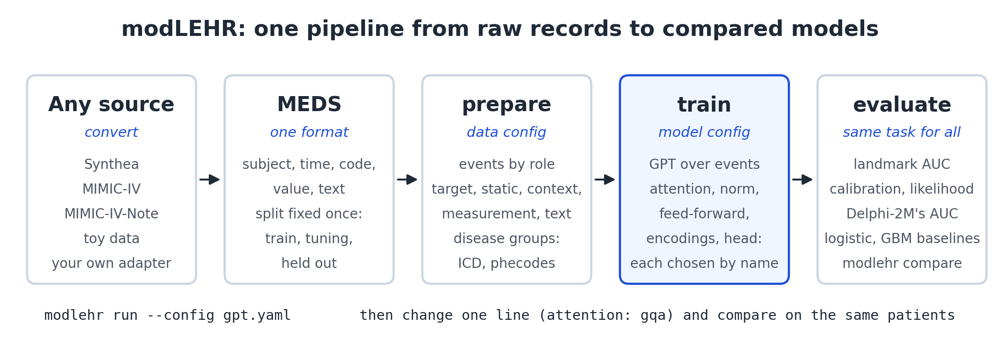

# modLEHR

modLEHR is a framework for modeling longitudinal electronic health records. Records from any source
are converted to one format, [MEDS](https://github.com/Medical-Event-Data-Standard/meds); one code
base turns them into timelines, trains a model and evaluates it; and every part of the model is
chosen by name in a config file. Change one name, train, and compare against the baseline on the
same patients with the same evaluation.



- **Data.** Converters for Synthea, MIMIC-IV (its diagnosis tables, or the full release through the
  official ETL) and MIMIC-IV-Note, a toy dataset that runs every command in a minute, and Synthea
  patients ready to download.
- **Models.** A GPT over events, with the patient's age in place of position and a rate per year for
  every outcome. Attention, normalization, feed-forward, value and text encodings are swappable by name.
  Delphi-2M (Shmatko et al., *Nature* 2025) is included as a model of its own (`model.architecture:
  delphi2m`), checked to train the same model as its authors' code.
- **Evaluation.** AUC at landmark ages, calibration, likelihood and Delphi-2M's own AUC, with logistic
  regression and gradient boosting on exactly the same task. `modlehr compare` gives paired
  differences with intervals over seeds.

## Installation

Python 3.11 or newer and PyTorch 2.4 or newer. Training uses CUDA if available, then Apple MPS, then
the CPU.

```bash
git clone https://github.com/Jimmuji/modLEHR.git && cd modLEHR
python -m venv .venv && .venv/bin/pip install -e ".[dev]"
.venv/bin/python -m pytest          # 110 tests, about 20 seconds
```

Run every command from the repository root. `modlehr` below means `.venv/bin/modlehr`.

## Try it in a minute

A synthetic toy dataset (2,000 subjects, three diseases, an HbA1c measurement, a discharge note each)
runs every stage on a laptop CPU in about 16 seconds:

```console
$ modlehr convert toy --out data/toy_meds
$ modlehr run --config configs/experiment/toy_gpt.yaml
[prepare] vocabulary 11 tokens, 4 targets → runs/prepared/toy
[train] best tuning loss 3.6908 → runs/toy_gpt/best.pt
[evaluate] mean AUC 0.613 (95% CI 0.472 to 0.753) over 10 target and landmark pairs, controls=at_risk, risk=marginal
$ modlehr baseline --config configs/experiment/toy_gpt.yaml
[baseline] logistic: mean AUC 0.487 (95% CI 0.456 to 0.517) over 10 pairs → runs/toy_gpt_logistic/evaluate.csv
```

The toy notes mention "polyuria" for subjects who will develop disease A, so the transformer, which
reads note words, beats a logistic regression that sees only codes. The data exist to exercise the
code, not to learn from.

## Run an experiment

One config says what is read, what is predicted and which model parts to use. Each event rule gives a
set of codes a role: targets are predicted (and read as history), every other role is only read.
From `configs/data/mimic_iv_core.yaml` and `configs/experiment/mimic_iv_core_gpt.yaml`, shortened:

```yaml
data:
  meds_dir: data/mimic_iv_core_meds
  target_grouping: icd_gems          # ICD-10 categories, ICD-9 mapped through the CMS GEMs
  events:
    - {name: sex, role: static, prefix: "GENDER//"}
    - {name: death, role: target, codes: ["MEDS_DEATH"]}
    - {name: diagnoses, role: target, prefix: "DIAGNOSIS//ICD//"}
    - {name: admissions, role: context, prefix: "HOSPITAL_ADMISSION//"}
    - {name: emergency, role: context, codes: ["ED_REGISTRATION"]}
model: {d_model: 256, n_layers: 6, attention: mha, ffn: gelu_mlp}
evaluate: {landmarks: [40, 50, 60, 70, 80], horizon_years: 2}
```

```bash
modlehr run --config configs/experiment/synthea_gpt.yaml --seed 1                  # prepare, train, evaluate
modlehr run --config configs/experiment/synthea_gpt.yaml --seed 1 \
  --set model.attention=gqa --set train.out_dir=runs/synthea_gpt_gqa                 # swap one part
modlehr compare runs/synthea_gpt_s1 runs/synthea_gpt_gqa_s1 runs/synthea_gpt_logistic # paired differences
```

<details>
<summary><b>All commands</b></summary>

| Command | What it does |
|---|---|
| `modlehr convert toy` | Write a small synthetic MEDS dataset |
| `modlehr convert synthea` | Synthea CSV export → MEDS |
| `modlehr convert mimic-iv-core` | MIMIC-IV's diagnosis tables (patients, admissions, diagnoses) → MEDS |
| `modlehr convert mimic-iv-note` | Merge MIMIC-IV-Note into MIMIC-IV MEDS as text events |
| `modlehr validate` | Check a MEDS dataset against the official schemas |
| `modlehr prepare` | Select events, compute ages, group disease codes, build vocabularies, handle values, attach labels |
| `modlehr info` | Summarize a prepared dataset |
| `modlehr train` | Fit the model; keep the checkpoint with the lowest tuning loss |
| `modlehr evaluate` | Landmark AUC, calibration and held-out likelihood |
| `modlehr baseline` | Logistic regression and gradient boosting on the same task |
| `modlehr generate` | Sample future outcomes for one patient |
| `modlehr simulate` | Sample one future per held-out patient and compare incidence by age with the records |
| `modlehr delphi` | Delphi-2M's own AUC, to set a model next to Delphi-2M's published numbers |
| `modlehr export-delphi` | Write a prepared dataset in Delphi-2M's format, so its own code trains on the same data |
| `modlehr run` | `prepare` (only if needed), `train` and `evaluate` in one command |
| `modlehr compare` | Mean AUC of several runs and paired differences, with 95% intervals over pairs and seeds |

What each one reads and writes: [docs/pipeline.md](docs/pipeline.md).

</details>

<details>
<summary><b>Model parts you can swap</b></summary>

| Kind | Registered names |
|---|---|
| `attention` | `mha`, `gqa`, `mla`, `rope`, `rope_age`, `alibi_age`, `local_age`; any of them with `qk_norm: true` |
| `norm` | `layernorm`, `rmsnorm` |
| `ffn` | `gelu_mlp`, `swiglu`, `moe` |
| `time_encoding` | `sinusoidal_age`, `none` |
| `value_encoding` | `none`, `mlp` |
| `text_encoding` | `none`, `hashed_bag` |
| `head` | `competing_risk` |
| `architecture` | `modlehr` (the parts above), `delphi2m` (Delphi-2M's own model and training) |
| `target_grouping` | `identity`, `icd10_3char`, `icd_3char`, `icd_gems`, `phecode` |

How each works: [docs/model.md](docs/model.md). Adding your own: [docs/extending.md](docs/extending.md).

</details>

<details>
<summary><b>Quick start on Synthea</b> (synthetic patients, from download to sampled futures)</summary>

[Synthea](https://github.com/synthetichealth/synthea) simulates complete patient records from
published statistics; its data are public domain. It is not real data, so it checks that everything
runs; model comparisons belong on real records.

**1. Download 22,962 synthetic patients, already in MEDS** (151 MB, from
[Hugging Face](https://huggingface.co/datasets/Jimmu1215/modlehr-synthea)):

```bash
pip install huggingface_hub
hf download Jimmu1215/modlehr-synthea --repo-type dataset --local-dir data/synthea_meds
```

**2. Check it:**

```console
$ modlehr validate --meds-dir data/synthea_meds
data/synthea_meds: 30 shards, 1,229 codes, 22,962 subjects; valid
```

To generate your own patients instead, Synthea needs Java 11: download `synthea-with-dependencies.jar`
from the [Synthea releases](https://github.com/synthetichealth/synthea/releases) (tested with 3.4.0), then

```bash
java -jar synthea-with-dependencies.jar -p 20000 -s 20260919 \
  --exporter.baseDirectory data/synthea_raw \
  --exporter.csv.export true --exporter.fhir.export false \
  --exporter.csv.included_files patients.csv,conditions.csv,observations.csv \
  --exporter.years_of_history 0 --generate.only_alive_patients false
modlehr convert synthea --raw-dir data/synthea_raw --out data/synthea_meds
```

`years_of_history 0` keeps the whole life rather than the last 10 years, and
`only_alive_patients false` keeps people who die, so death can be predicted. Synthea runs on several
threads, so the same seed can give a slightly different population.

**3. Prepare timelines** (20 seconds):

```console
$ modlehr prepare --config configs/experiment/synthea_gpt.yaml
...
[prepare] rule               role            codes   tokens     kept       events
[prepare] sex                static              2        2        2       22,962
[prepare] death              target              1        1        1        2,962
[prepare] disorders          target            210      210      163      323,337
[prepare] smoking            categorical         1        3        3       33,084
[prepare] measurements       measurement        13       39       39    3,146,050
[prepare] vocabulary 209 tokens, 164 targets → runs/prepared/synthea_binned
```

**4. Train** (3,000 steps, 5 minutes on Apple MPS):

```console
$ modlehr train --config configs/experiment/synthea_gpt.yaml
[train] 1.25M parameters, 209 tokens, 164 targets, device mps
...
[train] best tuning loss 4.7806 → runs/synthea_gpt/best.pt
```

**5. Evaluate, against classical models:**

```console
$ modlehr evaluate --config configs/experiment/synthea_gpt.yaml
[evaluate] mean AUC 0.589 (95% CI 0.564 to 0.614) over 124 target and landmark pairs
$ modlehr baseline --config configs/experiment/synthea_gpt.yaml
[baseline] logistic: mean AUC 0.612 (95% CI 0.586 to 0.637) over 124 pairs → runs/synthea_gpt_logistic/evaluate.csv
[baseline] gbm: mean AUC 0.606 (95% CI 0.579 to 0.633) over 124 pairs → runs/synthea_gpt_gbm/evaluate.csv
```

**6. Sample futures for one patient:**

```console
$ modlehr generate --config configs/experiment/synthea_gpt.yaml --subject 8 --start-age 55 --horizon 15
sample 0:
   57.89  SNOMEDCT//68496003             Polyp of colon (disorder)
   62.84  SNOMEDCT//403190006            Epidermal burn of skin (disorder)
   69.25  SNOMEDCT//414545008            Ischemic heart disease (disorder)
sample 1:
   56.15  SNOMEDCT//368581000119106      Neuropathy due to type 2 diabetes mellitus (disorder)
   ...
sample 2:
   57.01  MEDS_DEATH                     Death
```

</details>

<details>
<summary><b>MIMIC-IV</b> (credentialed data from PhysioNet)</summary>

```bash
RAW=~/mimic_dl/physionet.org/files/mimiciv/3.1 scripts/run_mimic_iv_core.sh   # diagnoses, admissions, ED visits, death
RAW=~/mimic_dl/physionet.org/files/mimiciv/3.1 scripts/run_mimic_iv.sh        # the full release: labs, medications, ICU
```

MIMIC-IV may only be used under its PhysioNet data use agreement: run it in your own environment and
share summary numbers only, never rows. Details, the notes module and other sources:
[docs/data.md](docs/data.md).

</details>

## Results so far

On MIMIC-IV diagnoses (364,627 patients, 1,018 targets, first diagnosis within 2 years after ages 40
to 80):

| Model | Mean AUC |
|---|---|
| Plain GPT, 5.3M parameters, 5 seeds | 0.676 |
| Nine other architectures (GQA, MLA, RoPE, ALiBi, SwiGLU, MoE, ...) | 0.676 to 0.677 |
| Plain GPT + BMI | 0.701 |
| Logistic regression, same inputs | 0.653 |

No architecture moves AUC by more than 0.001; adding an outpatient BMI reading adds 0.025. Full
tables, calibration and the Synthea results: [docs/results.md](docs/results.md).

## Documentation

| | |
|---|---|
| [docs/pipeline.md](docs/pipeline.md) | Each stage: what it reads, does and writes; running and comparing experiments |
| [docs/model.md](docs/model.md) | The input head, blocks and competing-risks head, and every swappable part |
| [docs/data.md](docs/data.md) | The MEDS format, MIMIC-IV, clinical notes and other sources |
| [docs/configuration.md](docs/configuration.md) | Every config key and its default |
| [docs/disease_codes.md](docs/disease_codes.md) | Disease codes and how they become prediction targets |
| [docs/extending.md](docs/extending.md) | Adding a model part or a data source |
| [docs/delphi.md](docs/delphi.md) | Delphi-2M in modLEHR: training it, how it differs from the GPT, and its authors' code on the same data |
| [docs/results.md](docs/results.md) | Full results |
| [docs/design.md](docs/design.md) | Design notes |
| [docs/troubleshooting.md](docs/troubleshooting.md) | Common problems |

<details>
<summary><b>Repository layout</b></summary>

```
configs/
  data/            which MEDS dataset, which events, how to tokenize them
  model/           which registered parts make up the model
  experiment/      data + model + training + evaluation for one run
src/modlehr/
  data/            MEDS reader and validation; adapters/ convert sources to MEDS; toy.py
  prepare/         event selection, target grouping, vocabularies, values, labels, batches
  model/           input head, swappable layers, output heads, the assembled model; delphi.py, Delphi-2M
  train/           training loop; delphi.py, Delphi-2M's training and data format
  evaluate/        landmark task, AUC, calibration, likelihood, baselines, Delphi-2M's AUC, comparison
  generate/        sampling futures
  registry.py      name → part, for everything that can be swapped
  config.py        configuration and command-line overrides
  cli.py           the commands
scripts/           end-to-end runs (run_mimic_iv*.sh, compare_*.sh), downloads (fetch_*.sh),
                   analysis/: tables and figures from evaluated runs
tests/             unit tests and end-to-end tests on a tiny synthetic MEDS dataset
docs/              the documentation above
```

</details>

## License

The code is under the MIT License ([LICENSE](LICENSE)). Data keeps its own terms: Synthea output is
free to share, MIMIC-IV may only be used under its PhysioNet data use agreement, and
`scripts/compare_delphi_code.sh` fetches Delphi-2M's code, which is under the MIT License too (its
model weights are not, and are not used here).
